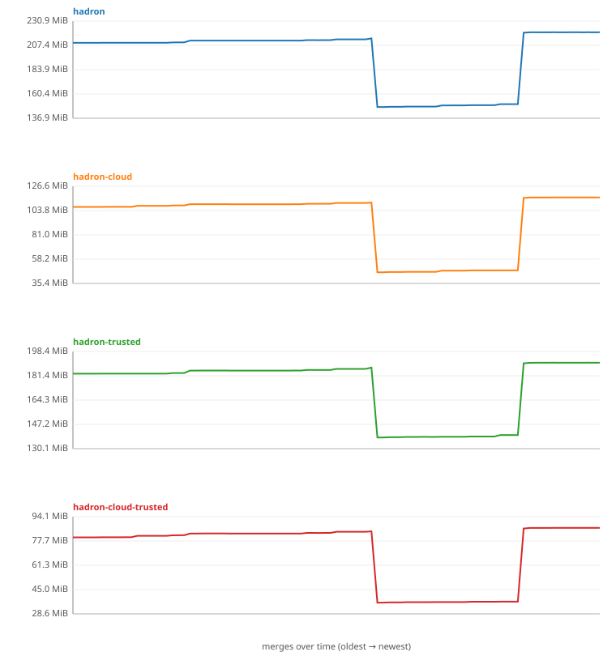

# 📦 Image size history

Uncompressed rootfs size (sum of regular files, amd64) of each shipped
`:main` image, recorded once per merge. The CSV (`size-history.csv`) is the
source of truth; this page and the chart are regenerated from it by
`.github/scripts/size-history.sh`.

## Most recent 20 merges

| date | sha | hadron | hadron-cloud | hadron-trusted | hadron-cloud-trusted |
|---|---|--:|--:|--:|--:|
| 2026-11-24 | [`fcc0781e1268`](https://github.com/kairos-io/hadron/commit/fcc0781e126834c011533ee0e2f07e035e57c063) | 223MB (-5.8KB) | 117MB (+65B) | 193MB (-5.8KB) | 87MB (+64B) |
| 2026-11-23 | [`e9704a0f1911`](https://github.com/kairos-io/hadron/commit/e9704a0f191189cac5659f1201357eaab747a378) | 223MB (+2.2MB) | 117MB (-38B) | 193MB (+2.2MB) | 87MB (-36B) |
| 2026-11-23 | [`1d5f81aac0aa`](https://github.com/kairos-io/hadron/commit/1d5f81aac0aa362694a3effe85343c94d055296a) | 221MB (-4.3KB) | 117MB (-253B) | 191MB (-4.3KB) | 87MB (-255B) |
| 2026-11-23 | [`09cbc2994ec1`](https://github.com/kairos-io/hadron/commit/09cbc2994ec1b2f9bd8830f1749c360ca7c4985f) | 221MB (+18KB) | 117MB (+18KB) | 191MB (-694B) | 87MB (+70B) |
| 2026-11-21 | [`de1146a72636`](https://github.com/kairos-io/hadron/commit/de1146a72636cb4866ff83f45d2eb35ec9797d40) [`v0.6.7`](https://github.com/kairos-io/hadron/releases/tag/v0.6.7) | 221MB (+4.9KB) | 117MB (+59B) | 191MB (+5.0KB) | 87MB (+133B) |
| 2026-11-20 | [`5c9c251c62d9`](https://github.com/kairos-io/hadron/commit/5c9c251c62d9ef4c7ec935a3189a8034de3904a9) | 221MB (+0B) | 117MB (+0B) | 191MB (+0B) | 87MB (+0B) |
| 2026-11-20 | [`2a23c6cea4d7`](https://github.com/kairos-io/hadron/commit/2a23c6cea4d77611c6f0adbbdc14945f5285551f) | 221MB (-3.5KB) | 117MB (+23B) | 191MB (-3.5KB) | 87MB (+23B) |
| 2026-11-20 | [`2be1352ed636`](https://github.com/kairos-io/hadron/commit/2be1352ed6364bedde3b98e60a1f2ca9a859d2d2) | 221MB (+0B) | 117MB (+0B) | 191MB (+0B) | 87MB (+0B) |
| 2026-11-20 | [`b677b9c3dfdd`](https://github.com/kairos-io/hadron/commit/b677b9c3dfddbb4143de91d171515daa2d76d7ec) | 221MB (+0B) | 117MB (+0B) | 191MB (+0B) | 87MB (+0B) |
| 2026-11-20 | [`54d2681faf1a`](https://github.com/kairos-io/hadron/commit/54d2681faf1a150f442cefee65e826570f3e3391) | 221MB (-1.9KB) | 117MB (+47B) | 191MB (+1.3KB) | 87MB (+48B) |
| 2026-11-19 | [`05da905cd35e`](https://github.com/kairos-io/hadron/commit/05da905cd35ef8958f9536e8c9824ac8d8667b27) | 221MB (+36KB) | 117MB (+77KB) | 191MB (+29KB) | 87MB (+72KB) |
| 2026-11-19 | [`16f775e95d6d`](https://github.com/kairos-io/hadron/commit/16f775e95d6d741f893a9f3d86885e399f00ee7b) | 221MB (+0B) | 117MB (-374B) | 191MB (-1.4KB) | 87MB (+0B) |
| 2026-11-19 | [`61d16290e4eb`](https://github.com/kairos-io/hadron/commit/61d16290e4eb10dad4aa16b0fcf48453667b9a9e) | 221MB (-861B) | 117MB (+0B) | 191MB (+4.8KB) | 87MB (+0B) |
| 2026-11-19 | [`f5361bfb41da`](https://github.com/kairos-io/hadron/commit/f5361bfb41daa9f0012ca0d2a9b786f4c9bb26ec) [`v0.6.6`](https://github.com/kairos-io/hadron/releases/tag/v0.6.6) | 221MB (+1.2KB) | 117MB (+263B) | 191MB (-2.1KB) | 87MB (+0B) |
| 2026-11-18 | [`cd779deaa986`](https://github.com/kairos-io/hadron/commit/cd779deaa98647209a7bcd0bc82af796df437a7e) | 221MB (-3.2KB) | 117MB (+0B) | 191MB (-3.8KB) | 87MB (-280B) |
| 2026-11-17 | [`4600bc82989b`](https://github.com/kairos-io/hadron/commit/4600bc82989b79b9dfae946c3bcb34946a0dd707) | 221MB (+3.7KB) | 117MB (-301B) | 191MB (+3.4KB) | 87MB (+406B) |
| 2026-11-17 | [`d68d2ff28153`](https://github.com/kairos-io/hadron/commit/d68d2ff28153fa20a14e42575e788555725a2b6d) | 221MB (-1.7KB) | 117MB (+568B) | 191MB (+141B) | 87MB (-308B) |
| 2026-11-16 | [`de78cc12d41f`](https://github.com/kairos-io/hadron/commit/de78cc12d41f88b5a4035bfa09ef3776b737995d) | 221MB (+218B) | 117MB (-109B) | 191MB (+2.4KB) | 87MB (+173B) |
| 2026-11-16 | [`a3a7843fe79c`](https://github.com/kairos-io/hadron/commit/a3a7843fe79c026b29b3a2eb40e2b4831f3d62b3) | 221MB (+1.5KB) | 117MB (+195B) | 191MB (-3.3KB) | 87MB (+0B) |
| 2026-11-12 | [`7b3a3c728989`](https://github.com/kairos-io/hadron/commit/7b3a3c7289898306f524615ad4120caeaa8813ad) [`v0.6.5`](https://github.com/kairos-io/hadron/releases/tag/v0.6.5) | 221MB (+12B) | 117MB (+0B) | 191MB (+1.1KB) | 87MB (-279B) |

