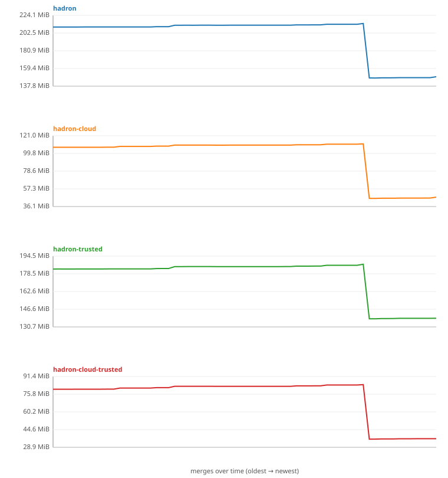

# 📦 Image size history

Uncompressed size (`docker image inspect .Size`, amd64) of each shipped
`:main` image, recorded once per merge. The CSV (`size-history.csv`) is the
source of truth; this page and the chart are regenerated from it by
`.github/scripts/size-history.sh`.

## Most recent 20 merges

| date | sha | hadron | hadron-cloud | hadron-trusted | hadron-cloud-trusted |
|---|---|--:|--:|--:|--:|
| 2026-10-22 | [`ac2337e862af`](https://github.com/kairos-io/hadron/commit/ac2337e862af7319a9bbd6cf624e9ffd6e802248) | 151MB (+88B) | 48MB (-52B) | 140MB (-33B) | 37MB (+177B) |
| 2026-10-22 | [`54489e3e4e1e`](https://github.com/kairos-io/hadron/commit/54489e3e4e1e18fe810200cadb06756ed2fc0270) | 151MB (+1.1MB) | 48MB (+40KB) | 140MB (+1023KB) | 37MB (+47KB) |
| 2026-10-21 | [`3b821526fa4d`](https://github.com/kairos-io/hadron/commit/3b821526fa4d689aa9e0c32aacfdecc3a63fabb9) | 150MB (+1.6KB) | 48MB (-806B) | 139MB (+3.5KB) | 37MB (+190B) |
| 2026-10-21 | [`20b6dd0048f5`](https://github.com/kairos-io/hadron/commit/20b6dd0048f58d68a95d6b2f318f7da7adf73a39) | 150MB (-2.0KB) | 48MB (+141B) | 139MB (-2.3KB) | 37MB (-393B) |
| 2026-10-20 | [`b133361d4c8a`](https://github.com/kairos-io/hadron/commit/b133361d4c8a22c74d0f285982c6da5973f28ce3) | 150MB (+2.2KB) | 48MB (+6B) | 139MB (+3.5KB) | 37MB (+279B) |
| 2026-10-20 | [`5a3a827a69f0`](https://github.com/kairos-io/hadron/commit/5a3a827a69f0421b53ba3a9a80a1472c48012339) | 150MB (-3.3KB) | 48MB (+476B) | 139MB (-3.9KB) | 37MB (-47B) |
| 2026-10-19 | [`0c1856e83447`](https://github.com/kairos-io/hadron/commit/0c1856e83447ebc726c4f7c929fc0448aaab7433) [`v0.6.1`](https://github.com/kairos-io/hadron/releases/tag/v0.6.1) | 150MB (+216KB) | 48MB (+217KB) | 139MB (+226KB) | 37MB (+212KB) |
| 2026-10-19 | [`a88265640b6d`](https://github.com/kairos-io/hadron/commit/a88265640b6dc14877b4d38e701bce1ef56414ec) | 150MB (+542B) | 48MB (+20KB) | 139MB (-19KB) | 37MB (+164B) |
| 2026-10-16 | [`2a0fcc5feccf`](https://github.com/kairos-io/hadron/commit/2a0fcc5feccfa401f0ab7b253a23014e25c80819) | 150MB (+18KB) | 48MB (+4.8KB) | 139MB (+6.4KB) | 37MB (+1.8KB) |
| 2026-10-15 | [`099f09087506`](https://github.com/kairos-io/hadron/commit/099f090875060c230d009f22feadea49c97a1b45) | 150MB (+6.6KB) | 48MB (+16KB) | 139MB (+3.1KB) | 37MB (+19KB) |
| 2026-10-14 | [`da24f8255076`](https://github.com/kairos-io/hadron/commit/da24f825507601626ee15f36e46929fa134e742f) [`v0.6.0`](https://github.com/kairos-io/hadron/releases/tag/v0.6.0) | 150MB (+798B) | 48MB (-267B) | 139MB (+737B) | 37MB (-65B) |
| 2026-10-13 | [`65ed5a0db340`](https://github.com/kairos-io/hadron/commit/65ed5a0db340f5f0a77c20fe4343d39c3655e0f8) | 150MB (+1.2MB) | 48MB (+1.2MB) | 139MB (+88KB) | 37MB (+157B) |
| 2026-10-08 | [`ce78a7c638b1`](https://github.com/kairos-io/hadron/commit/ce78a7c638b1ab6e060cbaa65771acef7d3aa99b) | 149MB (+3.2KB) | 47MB (+5.4KB) | 139MB (+1.9KB) | 37MB (+11KB) |
| 2026-10-07 | [`c485330e9d07`](https://github.com/kairos-io/hadron/commit/c485330e9d076d95a049472a20dec9493b99b268) | 149MB (-26KB) | 47MB (+4.6KB) | 139MB (-28KB) | 37MB (+3.0KB) |
| 2026-10-01 | [`58ff4996e568`](https://github.com/kairos-io/hadron/commit/58ff4996e568e03220e1f3758f54ffb01140a649) | 149MB (+25KB) | 47MB (+15KB) | 139MB (+20KB) | 37MB (+21KB) |
| 2026-10-01 | [`b5f07fc13db7`](https://github.com/kairos-io/hadron/commit/b5f07fc13db73a38e233dc0aab0d600119825a1b) | 149MB (-4.8KB) | 47MB (-6.0KB) | 139MB (-1.1KB) | 37MB (+732B) |
| 2026-09-30 | [`82495b7bbd5c`](https://github.com/kairos-io/hadron/commit/82495b7bbd5c056e872b154e82f7c7a2830a0da7) | 149MB (-3.6KB) | 47MB (+2.8KB) | 139MB (-2.5KB) | 37MB (-133B) |
| 2026-09-29 | [`f824b1d9929f`](https://github.com/kairos-io/hadron/commit/f824b1d9929f18b32ee33824a2706d9a632d28c5) | 149MB (+191KB) | 47MB (+186KB) | 139MB (+179KB) | 37MB (+181KB) |
| 2026-09-28 | [`cb6c3010c01a`](https://github.com/kairos-io/hadron/commit/cb6c3010c01a03afd589cdc517817de36c7615b0) | 148MB (+35KB) | 47MB (+6.9KB) | 139MB (+55KB) | 37MB (-3.1KB) |
| 2026-09-25 | [`a1d66f7a64a4`](https://github.com/kairos-io/hadron/commit/a1d66f7a64a45a7287a849224b1c400e97415f30) | 148MB (+8.2KB) | 47MB (+130B) | 139MB (+984B) | 37MB (-272B) |

